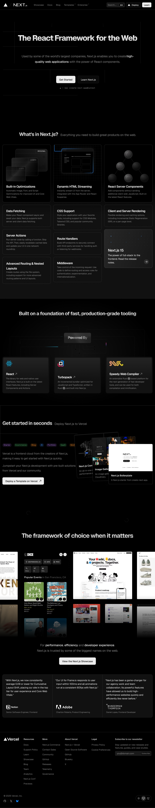
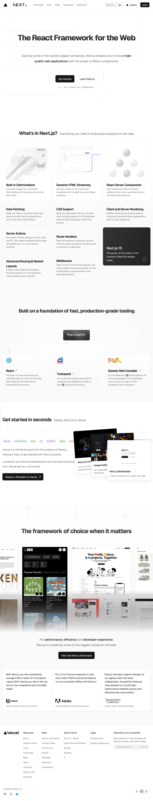
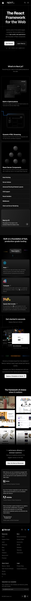
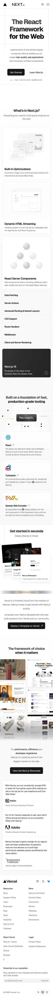

# Next Website React

A modern, responsive frontend project built with React, JavaScript, Vite, and Tailwind CSS v4.

<p align="center">
  
  
  
  
</p>

---

## Overview

**Next Website React** is a frontend development project focused on building a modern, responsive, and maintainable web application.

The project uses a component-based architecture and a modular folder structure to organize application logic, reusable UI components, feature-specific functionality, API services, and shared utilities.

It is built with modern React technologies and follows clean code and scalable frontend development practices.

## Table of Contents

- [Overview](#overview)
- [Design Preview](#design-preview)
- [Tech Stack](#tech-stack)
- [Project Features](#project-features)
- [Getting Started](#getting-started)
- [Environment Variables](#environment-variables)
- [Available Scripts](#available-scripts)
- [Project Architecture](#project-architecture)
- [Development Guidelines](#development-guidelines)
- [Project Status](#project-status)
- [Author](#author)
- [License](#license)

---

## Design Preview

The UI/UX design is created in Figma and includes desktop and mobile layouts with black and white visual themes.

**Figma Design:** [View Next Website React Design](https://www.figma.com/design/6jmQOaVAZsAOgdMkurVaN3/Untitled?t=uNK5WCIvHQZtdCV7-0)

### Desktop Designs

<p align="center">
  
  
</p>

### Mobile Designs

<p align="center">
  
  
</p>

These design references are used as visual guidelines throughout the frontend implementation.

---

## Tech Stack

| Technology | Purpose |
|---|---|
| React | Component-based UI development |
| JavaScript (ES6+) | Application logic |
| Vite | Development server and build tooling |
| Tailwind CSS v4 | Utility-first styling |
| React Router DOM | Client-side routing |
| Axios | HTTP requests and API communication |
| TanStack Query | Server-state management |
| Zustand | Global state management |
| CSS3 | Global styles and custom styling |
| Git & GitHub | Version control and source management |

---

## Project Features

### Application Architecture

- Modular and organized project structure
- Reusable React components
- Centralized application providers
- Client-side routing configuration
- Shared application layouts
- Feature-based code organization

### Data Management

- Axios-based API client setup
- Centralized API endpoint definitions
- TanStack Query integration
- Zustand store setup
- Local mock data support
- Reusable custom hooks

### Design and Styling

- Figma desktop and mobile design references
- Black and white design variations
- Tailwind CSS v4 integration
- Global CSS reset and variables
- Reusable UI components

---

## Getting Started

Follow these steps to run the project locally.

### Prerequisites

Make sure you have the following installed:

- Node.js
- npm
- Git

### 1. Clone the Repository

```bash
git clone https://github.com/00mohammad/next-website-react.git
```

### 2. Navigate to the Project Directory

```bash
cd next-website-react
```

### 3. Install Dependencies

```bash
npm install
```

### 4. Configure Environment Variables

Create a `.env` file based on `.env.example`.

```env
VITE_API_URL=your_api_url
VITE_USE_MOCKS=true
```

### 5. Start the Development Server

```bash
npm run dev
```

Open the local URL displayed in your terminal.

---

## Environment Variables

The project uses environment variables to manage API configuration and mock data.

| Variable | Description |
|---|---|
| `VITE_API_URL` | Base URL of the backend API |
| `VITE_USE_MOCKS` | Enables local mock data when set to `true` |

**Example `.env` configuration:**

```env
VITE_API_URL=http://localhost:3000/api
VITE_USE_MOCKS=true
```

Do not commit your private `.env` file to GitHub.

---

## Available Scripts

| Command | Description |
|---|---|
| `npm run dev` | Starts the Vite development server |
| `npm run build` | Creates an optimized production build |
| `npm run preview` | Previews the production build locally |

### Production Build

To generate the production-ready files:

```bash
npm run build
```

The generated files will be available in the `dist/` directory.

---

## Project Architecture

The project follows a modular architecture that separates application setup, reusable components, feature-specific logic, services, and shared utilities.

### Folder Structure

```text
next-website-react/
│
├── public/
│   ├── favicon.svg
│   └── icons.svg
│
├── src/
│   │
│   ├── app/
│   │   ├── providers/
│   │   │   └── AppProviders.jsx
│   │   ├── router/
│   │   │   └── AppRouter.jsx
│   │   └── store/
│   │       └── useAppStore.js
│   │
│   ├── assets/
│   │   └── design/
│   │       └── references/
│   │           ├── desktop-black.png
│   │           ├── desktop-white.png
│   │           ├── mobile-black.png
│   │           └── mobile-white.png
│   │
│   ├── components/
│   │   ├── common/
│   │   │   └── Footer.jsx
│   │   ├── feedback/
│   │   │   ├── ErrorMessage.jsx
│   │   │   └── Loading.jsx
│   │   ├── navigation/
│   │   │   └── Header.jsx
│   │   └── ui/
│   │       └── Button.jsx
│   │
│   ├── config/
│   │   └── env.js
│   │
│   ├── constants/
│   │   └── app.js
│   │
│   ├── features/
│   │   ├── auth/
│   │   │   └── api/
│   │   │       └── authApi.js
│   │   └── products/
│   │       ├── api/
│   │       │   └── productsApi.js
│   │       └── hooks/
│   │           └── useProducts.js
│   │
│   ├── hooks/
│   │   └── useDebounce.js
│   │
│   ├── layouts/
│   │   └── MainLayout.jsx
│   │
│   ├── mocks/
│   │   └── data/
│   │       └── products.js
│   │
│   ├── pages/
│   │   ├── Error/
│   │   │   └── ErrorPage.jsx
│   │   ├── Home/
│   │   │   └── HomePage.jsx
│   │   └── NotFound/
│   │       └── NotFoundPage.jsx
│   │
│   ├── services/
│   │   └── api/
│   │       ├── client.js
│   │       └── endpoints.js
│   │
│   ├── styles/
│   │   └── base/
│   │       ├── reset.css
│   │       └── variables.css
│   │
│   ├── utils/
│   │   ├── cn.js
│   │   └── formatCurrency.js
│   │
│   ├── App.css
│   ├── App.jsx
│   ├── index.css
│   └── main.jsx
│
├── .editorconfig
├── .env.example
├── .gitignore
├── index.html
├── package.json
├── vite.config.js
└── README.md
```

### Architecture Overview

| Directory | Responsibility |
|---|---|
| `app/` | Application providers, routing, and global state |
| `assets/` | Design reference images and other project assets |
| `components/` | Shared and reusable UI components |
| `config/` | Environment and application configuration |
| `constants/` | Shared application constants |
| `features/` | Feature-specific API logic and hooks |
| `hooks/` | Reusable custom React hooks |
| `layouts/` | Shared application layouts |
| `mocks/` | Local mock data for development |
| `pages/` | Route-level application pages |
| `services/` | API client and endpoint configuration |
| `styles/` | Base styles, CSS reset, and variables |
| `utils/` | Shared helper functions and utilities |

### Application Entry Flow

The application starts from `main.jsx` and follows this structure:

```text
index.html
    │
    ▼
main.jsx
    │
    ▼
App.jsx
    │
    ├── AppProviders.jsx
    │
    └── AppRouter.jsx
            │
            ▼
        HomePage.jsx
```

---

## Development Guidelines

The project follows these development principles:

- Build reusable and maintainable React components.
- Keep components focused on a single responsibility.
- Separate UI logic from data-fetching logic.
- Organize code by features and application responsibilities.
- Use Tailwind CSS for utility-based styling.
- Keep shared configuration and utilities centralized.
- Maintain consistent naming conventions.
- Use meaningful Git commits to track project changes.

---

## Project Status

**Status:** In Development

The project is under active development. Its UI, reusable components, responsive layouts, and application functionality are being implemented progressively.

---

## Author

**Mohammad Honarmand**

Frontend Developer (React.js) & UI/UX Designer

- GitHub: [00mohammad](https://github.com/00mohammad)
- LinkedIn: [Mohammad Honarmande](https://www.linkedin.com/in/mohammad-honarmande-62ab39343/)

---

## License

No open-source license has been specified yet.

For reuse or redistribution permissions, please contact the author.

---

<p align="center">
  Built with React, JavaScript, and Tailwind CSS.
</p>